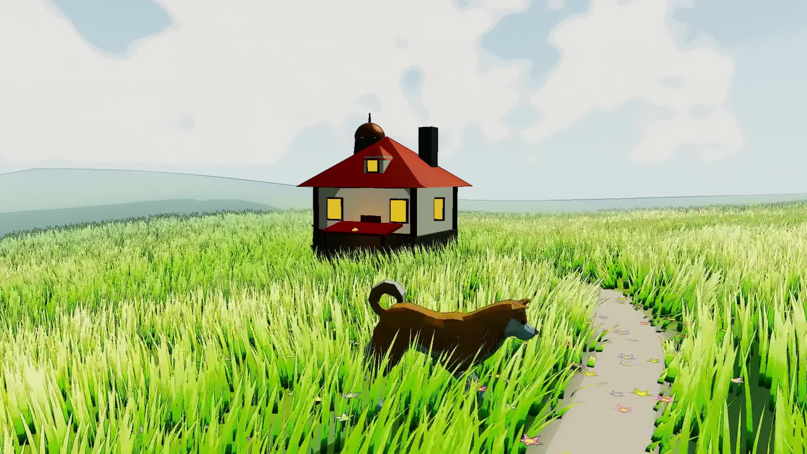

# 🌾 Studio Ghibli & Ni no Kuni Three.js Shaders

A real-time procedural landscape running in Three.js and WebGL, inspired by the background art of **Studio Ghibli** (Master *Kazuo Oga*) and Level-5 / Studio Ghibli's ***Ni no Kuni***. Featuring instanced anime tufted grass, spherical gouache cumulus cloud skies, an animated Doge (Shiba Inu) with realistic gallop kinematics and obstacle avoidance, a rustic watermill cottage with rotating water wheel and chimney smoke, and pleasant stereo meadow wind audio.



---

## 🎨 Features

1. **Instanced Anime Grass Field (`src/grass/`)**:
   * 160,000 curved, tufted grass blades with natural clumping.
   * Multi-harmonic wind wave simulation with shimmering sunlit crests.
   * Translucency & Subsurface Scattering (SSS) backlighting.
   * Dirt footpath blending seamlessly with terrain height.

2. **Master Kazuo Oga Sky Dome (`src/sky/`)**:
   * Multi-stop atmospheric watercolor gradient (deep cerulean zenith to warm pale gold horizon haze).
   * Spherical dome projection eliminating horizon stretching.
   * 4-Tier Gouache Cumulus Clouds: soft periwinkle shadow, warm peach-cream body, ivory highlight crest, and forward sun rim halo.
   * Cotton paper grain granulation simulating 300gsm watercolor paper.

3. **Fine-Art & Anime Post-Processing Suite (`src/shaders/artStylesShader.js`)**:
   * **Mode 2 (Default)**: **Anime Cel & Pencil Sketch** — Delicate graphite/ink contour linework along silhouettes with 4-tier anime cel wash stepping.
   * **Mode 1**: **Studio Ghibli Watercolor / Gouache** — Wet-on-wet paint diffusion, pigment edge pooling (meniscus effect), and Arches paper granulation.
   * **Mode 3**: **Oil Painting (Impasto)** — Kuwahara directional smoothing and palette-knife sheen.
   * **Mode 0**: **Pure 3D** — Unfiltered HDR rendering.

4. **Animated Doge Character (`src/animals/doge.js`)**:
   * Low-poly Shiba Inu character with smooth bone skeletal animation (`Gallop`, `Walk`, `Eating/Sniff`, `Jump`, `Idle`).
   * Calibrated stride cadence synchronized to ground displacement velocity ($8.2\text{ units/s}$ at $1.05\times$ playback rate) to eliminate foot slippage.
   * Auto-roaming waypoint navigation across the open meadow with **dynamic obstacle repulsion** to prevent any collision with the watermill cottage.
   * WASD / D-Pad manual control mode with Shift sprint and spacebar jump.

5. **Ghibli Watermill Cottage (`src/scenery/house.js`)**:
   * Mossy stone foundation, half-timbered plaster walls, terracotta gabled roof, and aged copper observatory dome.
   * Continuously rotating wooden water wheel.
   * Procedural chimney smoke particle system with breeze drift.

6. **Pleasant Meadow Wind Ambience (`public/audio/pleasant_wind.wav`)**:
   * 48kHz stereo procedural soundscape with gentle swelling wind gusts, whispering tall grass rustle, and subtle pastoral bird calls.
   * Seamless looping in the browser with mute/unmute toggle.

---

## 🎮 Controls

* **Orbit Camera**: Left-click drag to rotate, right-click drag to pan, scroll wheel to zoom.
* <kbd>H</kbd>: Toggle clean scenic view (show/hide all UI overlays and GUI menus).
* <kbd>M</kbd>: Mute / Unmute ambient meadow wind audio.
* **Manual Doge Control**:
  * <kbd>W</kbd> / <kbd>▲</kbd>: Move Forward
  * <kbd>S</kbd> / <kbd>▼</kbd>: Move Backward
  * <kbd>A</kbd> / <kbd>◄</kbd>: Turn Left
  * <kbd>D</kbd> / <kbd>►</kbd>: Turn Right
  * <kbd>Shift</kbd>: Sprint Gallop
  * <kbd>Space</kbd>: Jump
  * <kbd>E</kbd>: Sniff Flowers

---

## 🚀 Getting Started

### Prerequisites
* [Node.js](https://nodejs.org/) (v18+)
* npm

### Installation
```bash
# Clone the repository
git clone https://github.com/xyzzyapps/ghibli-threejs-shaders.git
cd ghibli-threejs-shaders

# Install dependencies
npm install

# Run the local development server
npm run dev
```

Visit [`http://localhost:5173/`](http://localhost:5173/) in your web browser.

### Production Build
```bash
npm run build
```

---

## 📜 License

This project is licensed under the **PolyForm Noncommercial License 1.0.0**.

See [LICENSE](./LICENSE) for details. For noncommercial, educational, research, and personal use only.
